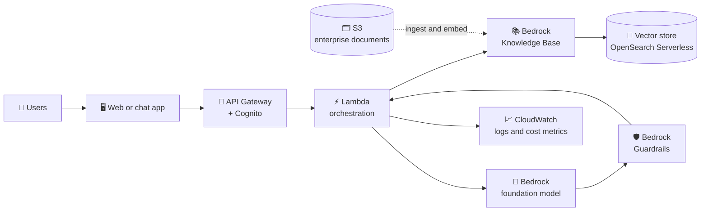
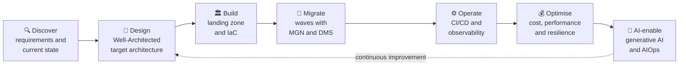

**Cloud Solution Architect @ Kyndryl India** · AWS & Azure · Hybrid Cloud · Migration & Modernisation · Generative AI · DevOps · FinOps

I design cloud solutions that are secure, scalable and cost-effective, and lead them from the first architecture workshop through migration and day-2 operations. 10+ years across infrastructure operations, DevOps and solution architecture, delivering migration and modernisation programmes for enterprise clients on AWS, Azure and hybrid cloud. I also bring AI and generative AI into cloud solutions, both as workloads to host and as tools that speed up delivery and operations.

---

## 🏗️ What I do as a Cloud Solution Architect

I turn business requirements into cloud architectures that are secure, resilient and cost-effective, then see them through migration, build and day-2 operations. My designs follow the AWS Well-Architected and Azure Well-Architected frameworks.

| Capability | What I deliver |
|---|---|
| 📐 **Solution design** | Requirements and current-state assessments, high- and low-level designs (HLD/LLD), architecture decision records, and reference architectures across AWS, Azure and hybrid |
| 🚚 **Migration & modernisation** | Portfolio discovery, 7R strategy per application, dependency mapping and wave plans; rehost and replatform with AWS MGN and DMS; modernising to containers on EKS |
| 🏛️ **Landing zones & governance** | Multi-account foundations with AWS Control Tower and Organizations, service control policies, tagging standards and IAM guardrails |
| 🌐 **Networking & hybrid connectivity** | VPC design, Direct Connect and VPN, DNS with Route 53, and load balancing and content delivery with ELB and CloudFront |
| 🔐 **Security & compliance** | Least-privilege IAM, encryption with KMS, audit trails with CloudTrail and AWS Config, and edge protection with WAF and Shield |
| 🛡️ **Resilience & DR** | High-availability designs and disaster recovery from backup-and-restore to warm standby, sized to agreed RTO and RPO |
| ⚙️ **Automation & DevOps** | Infrastructure as Code with Terraform, CloudFormation and Ansible; CI/CD with Jenkins and GitHub Actions |
| 📈 **Observability & operations** | Monitoring, logging and alerting with CloudWatch, Grafana and Elasticsearch; runbooks for day-2 operations |
| 💰 **Cost optimisation (FinOps)** | Cost visibility and showback, rightsizing, and savings plans and reservations, as a FinOps Certified Practitioner |
| 🤖 **AI & Generative AI solutions** | Architectures for generative AI applications on Amazon Bedrock and Azure OpenAI, including RAG over enterprise data, guardrails and secure private access |
| 🤝 **Stakeholder leadership** | Architecture workshops, design reviews and guiding delivery teams through agile execution |

### 🤖 AI & Generative AI on the cloud

How I apply AI as a Cloud Solution Architect:

- **Generative AI applications:** assistants and knowledge search built on Amazon Bedrock and Azure OpenAI, grounded in company data through retrieval-augmented generation (RAG)
- **Secure, governed AI platforms:** private endpoints, IAM and encryption for model access, Bedrock Guardrails for content safety, and data that stays inside the client's account
- **AI-assisted operations (AIOps):** LLMs that summarise logs and alerts, help triage incidents and draft runbook steps
- **AI-assisted migration:** faster discovery, dependency analysis and wave planning, with AI turning inventory data into migration recommendations
- **Cost control for AI (FinOps):** visibility of model-invocation, token and GPU spend, with right-sized model choices and budgets

**Reference architecture: RAG-based enterprise assistant on AWS**

### 🔄 How I deliver a cloud solution

### 🧰 Toolkit

| Area | Tools |
|---|---|
| **Cloud** |   |
| **Infrastructure as Code** |    |
| **Containers** |    |
| **CI/CD** |     |
| **Observability** |    |
| **AI & Generative AI** |      |
| **OS & scripting** |      |

## 📊 GitHub stats

<!-- Stats, streak and repo cards: generated daily by .github/workflows/snake.yml into the "output" branch -->
<picture>
  <source media="(prefers-color-scheme: dark)" srcset="https://raw.githubusercontent.com/ShailAdmin/ShailAdmin/output/stats-dark.svg" />
  
</picture>
<picture>
  <source media="(prefers-color-scheme: dark)" srcset="https://raw.githubusercontent.com/ShailAdmin/ShailAdmin/output/streak-dark.svg" />
  
</picture>

<!-- Activity graph: generated daily by .github/workflows/snake.yml into the "output" branch -->
<picture>
  <source media="(prefers-color-scheme: dark)" srcset="https://raw.githubusercontent.com/ShailAdmin/ShailAdmin/output/activity-graph-dark.svg" />
  
</picture>

<!-- Contribution snake: generated daily by .github/workflows/snake.yml into the "output" branch -->
<picture>
  <source media="(prefers-color-scheme: dark)" srcset="https://raw.githubusercontent.com/ShailAdmin/ShailAdmin/output/github-snake-dark.svg" />
  
</picture>

## 📂 Featured repositories

<a href="https://github.com/ShailAdmin/Cloud_Architect">
<picture>
  <source media="(prefers-color-scheme: dark)" srcset="https://raw.githubusercontent.com/ShailAdmin/ShailAdmin/output/repo-Cloud_Architect-dark.svg" />
  
</picture>
</a>
<a href="https://github.com/ShailAdmin/CheatSheet">
<picture>
  <source media="(prefers-color-scheme: dark)" srcset="https://raw.githubusercontent.com/ShailAdmin/ShailAdmin/output/repo-CheatSheet-dark.svg" />
  
</picture>
</a>

## 🏆 Certifications

- [AWS Certified Solutions Architect – Associate](https://www.credly.com/badges/ece99f42-f526-4763-b4d8-a38171c258d5/public_url)
- [FinOps Certified Practitioner](https://www.credly.com/badges/f8265be0-cea1-4843-8e75-9d4503817c7d/public_url)
- [AWS Partner: Generative AI Essentials (Business)](https://www.credly.com/badges/34f8657f-a29e-4e3a-a87b-6998c0a11ecb/public_url)

Other AWS training badges

- [AWS Cloud Quest: Cloud Practitioner](https://www.credly.com/badges/e14ea744-6673-4938-90c3-88b1c89f56c0/public_url)
- [AWS Knowledge: Migration Foundations](https://www.credly.com/badges/14d96cc9-d16c-4261-8baa-f21af81a719e/public_url)
- [AWS Knowledge: File Storage](https://www.credly.com/badges/e3d60348-e004-4280-a3fa-d8642241c66b/public_url)
- [AWS Educate: Getting Started with Compute](https://www.credly.com/badges/99cc47fe-1baf-496e-b29e-4dda4fcf54cd/public_url)

## 🌱 Currently exploring

- Agentic AI for cloud operations: assistants that can investigate incidents and run approved runbooks
- Retrieval-augmented generation (RAG) over architecture docs and runbooks with Amazon Bedrock
- Model Context Protocol (MCP) servers that connect AI assistants to cloud tooling
- Cost and governance patterns for running LLM workloads at enterprise scale

## 🤝 Community

Member of the [Linux Foundation community](https://community.linuxfoundation.org/) and the [FinOps Foundation](https://www.finops.org/); I share hybrid-cloud content on [YouTube](https://www.youtube.com/@hybridcloudcommunity) and [Medium](https://medium.com/@shailesh.gupta.ext).

📫 Open to conversations on cloud architecture, migration and modernisation, generative AI on the cloud, hybrid cloud and FinOps — reach me on [LinkedIn](https://www.linkedin.com/in/shailesh74).
